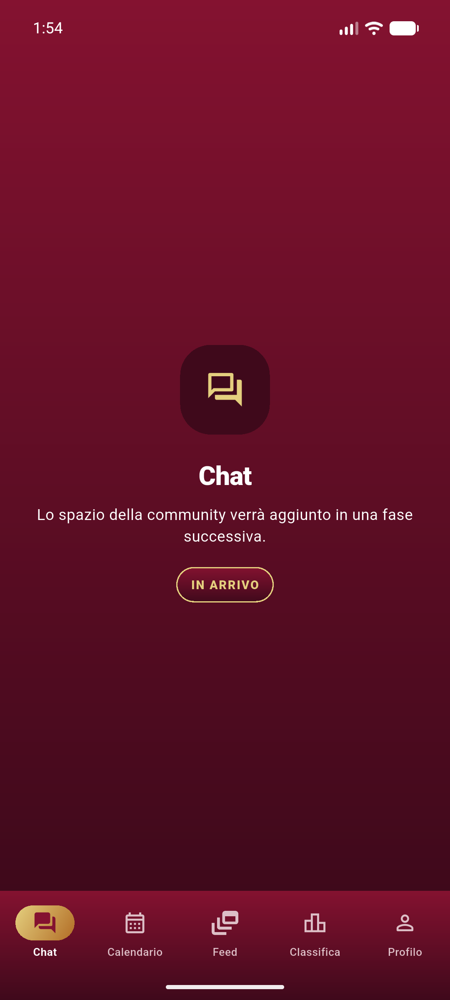
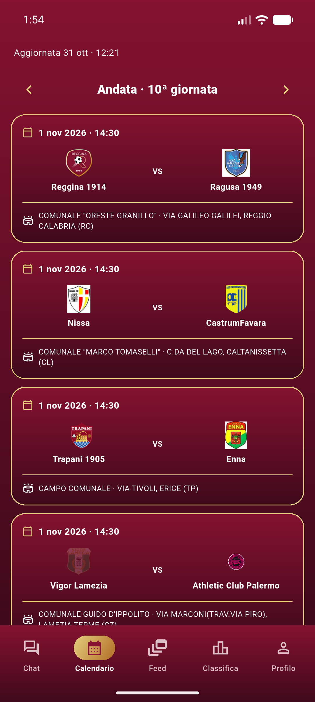
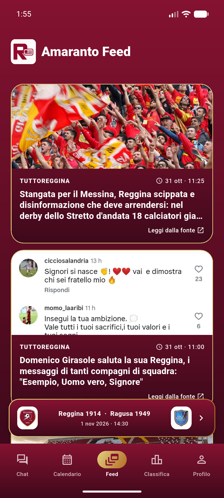
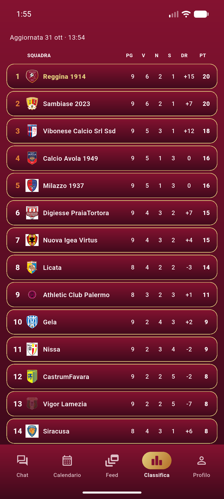
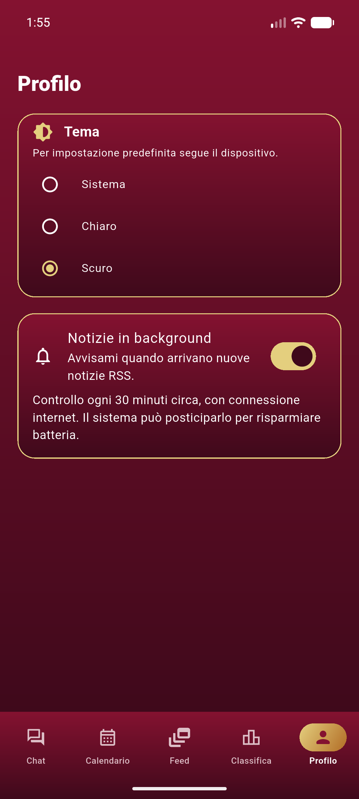

# Amaranto Feed

Standalone Flutter app for Reggina news, fixtures, and standings. No application server, hosted database, or API keys are required.

## Stable alpha scope

- The feed aggregates RSS headlines and opens the original article in an in-app browser.
- The next-match card opens a match detail page. Standings and matchdays load directly from the public LND competition page; completed match scores are shown in the calendar.
- Main tabs support horizontal swiping. The feed is the initial and centered tab.
- The app follows the system light/dark appearance by default; the profile page can override it.
- Chat and sign-in remain placeholders in this alpha.

LND parsing runs on the device. Standings and visited matchdays are cached locally for six hours; if LND is unavailable, the app shows the last successfully saved data for that season and matchday, with its original update time. Pull to refresh bypasses the cache. An internet connection is needed on first use and to fetch new data.

Chat and sign-in are still placeholders. Local storage does not synchronize between users or devices. A future shared chat will need a separate design for message delivery and persistence.

The current target is the native mobile app. A browser build would need a separate solution for third-party CORS restrictions on LND and RSS requests.

## Background news notifications

The app schedules an RSS check every 30 minutes with Workmanager, requiring an internet connection. It uses local notifications and needs notification permission. Profile → **Notizie in background** enables or disables both alerts and scheduled checks. Tapping a notification opens the newest article in the app.

Only previously unseen articles published after notifications were enabled and within the last 24 hours trigger alerts. Article URLs are remembered on-device for seven days, so relaunches and feed outages do not resend the same stories. Missing publication dates are excluded. Multiple new stories produce a single digest notification. Failed checks retry with exponential backoff; the initial launch does not send historical headlines.

Android may defer checks during Doze, battery restrictions, or loss of connectivity. Swiping the app away normally leaves the job scheduled; force-stopping it in system settings suspends work until the app is opened again. Workmanager persists the job across device restarts. The app does not keep a continuous foreground service running.

The iOS background task and notification configuration is included, but has not been built or tested in this Linux workspace. iOS chooses background execution times and cannot guarantee a 30-minute cadence. See the [Workmanager platform guide](https://docs.page/fluttercommunity/flutter_workmanager/quickstart) and [notification plugin documentation](https://pub.dev/packages/flutter_local_notifications/versions/21.0.0).

## Screenshots

Current dark theme, captured from the Android emulator. Refresh all five views
with `python tool/capture_screenshots.py` while the app is running.

| Chat | Calendario | Feed |
| --- | --- | --- |
|  |  |  |

| Classifica | Profilo |
| --- | --- |
|  |  |

## Local Android development

Flutter is pinned in `.fvmrc`. Install the pinned SDK and resolve Dart packages once with `./tool/dev.sh setup`, then use:

```sh
./tool/dev.sh format
./tool/dev.sh analyze
./tool/dev.sh test
./tool/dev.sh devices
./tool/dev.sh run
./tool/dev.sh preview # Format, analyze, and relaunch for UI review
./tool/dev.sh install
```

Native launch colors are generated from `lib/theme/app_theme.dart` by
`python tool/sync_native_theme.py` (requires Pillow). Android `run`/`install`
commands sync them automatically; run it before an iOS build after palette changes.
For reusable cold-launch screenshots: `python tool/capture_launch.py`.

The development script resolves Android SDK and selects the connected emulator automatically. Set `ANDROID_SERIAL` if more than one Android target is connected. No local API process is needed.
